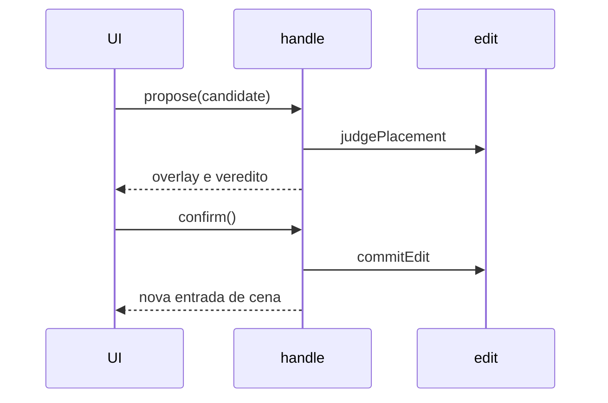

# review/editCommands

## Visão geral

Comandos de edição da revisão: propor uma posição, confirmar quando válida, desfazer e refazer, sem tocar no DOM.

## Responsabilidades

- Guardar o estado da edição e nunca alterar a entrada.
- Mostrar a posição candidata como overlay e anunciar a mudança de validade.
- Entregar uma nova entrada de cena depois de confirmar, desfazer ou refazer, sem o plano de corte enquanto ele estiver desatualizado.
- Recusar a confirmação de uma posição inválida mantendo os motivos.
- Recalcular o plano, o custo e o risco do layout editado, mostrar o plano novo e comparar com o original, descartando o resultado que parte de uma revisão antiga.

## Entradas e saídas

```ts
export function createEditHandle(args: EditHandleArgs): ReviewEditHandle
```

## Fluxo principal



## Tratamento de erros e casos-limite

Um artefato inválido deixa o handle desligado e com os motivos no estado. Comandos fora do modo de edição são ignorados.

## Exemplos

```ts
const handle = createEditHandle({ input, onScene, onOverlay, onAnnounce })
```

## Dependências e integrações

`../edit` e `./overlay`.
