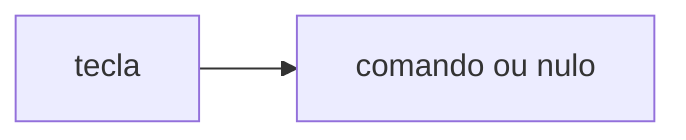

# review/editKeyMap

## Visão geral

Traduz teclas em comandos do modo de edição.

## Responsabilidades

- Setas deslocam (dez vezes com Shift), Q e E giram, M espelha, Enter confirma, Esc cancela, Ctrl+Z desfaz e Ctrl+Y ou Ctrl+Shift+Z refaz.
- Devolver nulo para qualquer outra tecla, deixando-a para o mapa de teclas da revisão.

## Entradas e saídas

```ts
export function editKeyCommand(event: EditKeyEvent, step: { move: number; rotate: number }): EditCommand | null
```

## Fluxo principal



## Tratamento de erros e casos-limite

Teclas sem modificador Ctrl que não são de edição devolvem nulo.

## Exemplos

```ts
const command = editKeyCommand({ key: 'ArrowRight', shiftKey: false, ctrlKey: false }, { move: 2, rotate: 15 })
```

## Dependências e integrações

Nenhuma.
