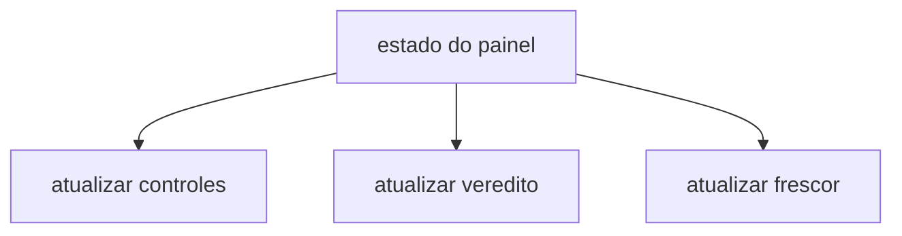

# review/editPanel

## Visão geral

Painel de edição: alternância do modo, escolha da peça e do tipo, campos numéricos, confirmar, cancelar, desfazer, refazer, veredito em texto e frescor dos resultados derivados.

## Responsabilidades

- Mostrar cada violação como texto, com o código no atributo `data-violation`.
- Desabilitar Confirmar quando o veredito não é válido.
- Avisar que o plano de corte está desatualizado e ocultado até o recálculo.
- Manter uma região `role="status"` para os anúncios.
- Oferecer o botão Recalcular, listar a comparação com o original e os avisos da edição.

## Entradas e saídas

```ts
export function editPanel(doc: Document, deps: EditPanelDeps): EditPanelHandle
```

## Fluxo principal



## Tratamento de erros e casos-limite

O painel não valida nada; apenas reflete o estado e dispara o handle.

## Exemplos

```ts
const panel = editPanel(document, { handle, onSelectPart })
```

## Dependências e integrações

`./messages`, `./panelText` e `./types`.
