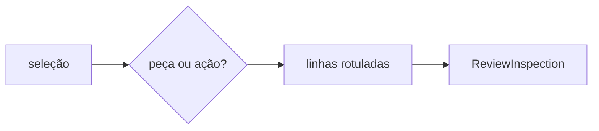

# inspect

## Visão geral

Monta o conteúdo do inspetor para uma peça ou ação selecionada.

## Responsabilidades

- Peça: chave, forma, instância, rotação, posição, limites, dados de origem (quando há forma), situação e a correlação do artefato (pedido, revisão, requisição).
- Ação: tipo, peça dona (ou "sem vínculo") e cada entrada de `metadata` exatamente como recebida.
- Incluir os avisos registrados contra a peça ou a ação.

## Entradas e saídas

```ts
export function inspect(scene: ReviewScene, selection: ReviewSelection): ReviewInspection
```

## Fluxo principal



## Tratamento de erros e casos-limite

Seleção que não existe resulta em inspeção vazia com a mensagem "Nenhuma peça ou ação selecionada.".

## Exemplos

```ts
inspect(scene, { kind: 'part', sheetId: 'sheet-1', partKey: 'part-1#0' }).rows
```

## Dependências e integrações

`./messages` e `./types`.
