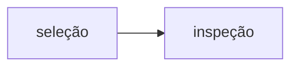

# inspectorPanel

## Visão geral

Inspetor da peça ou ação selecionada, com avisos registrados e botão "Limpar seleção".

## Responsabilidades

- Montar título, linhas e avisos a partir de `inspect`.
- Reconstruir o conteúdo somente quando a seleção muda, preservando o botão de limpar e o foco durante a reprodução.

## Entradas e saídas

```ts
export function inspectorPanel(doc: Document, scene: ReviewScene, controller: ReviewController): InspectorHandle
```

## Fluxo principal



## Tratamento de erros e casos-limite

Sem seleção mostra "Nenhuma peça ou ação selecionada.".

## Exemplos

```ts
const inspector = inspectorPanel(doc, scene, controller)
```

## Dependências e integrações

`./inspect`, `./messages`, `./panelText` e `./types`.
