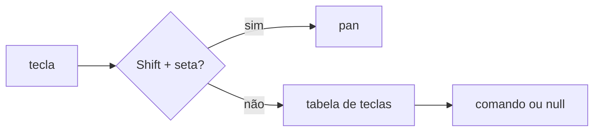

# keyCommand

## Visão geral

Traduz um evento de teclado em um comando da revisão. Módulo interno do controlador.

## Responsabilidades

- Mapear: Espaço (reproduzir/pausar), `r`, `n`, `<`, `>`, `[`, `]`, `,`, `.`, PageUp, PageDown, Home, End, setas (seleção), Enter, Esc, Shift+setas (mover a vista), `+`, `-` e `0`.
- Devolver `null` para teclas sem significado.

## Entradas e saídas

```ts
export function keyCommand(event: ReviewKeyEvent): ReviewCommand | null
```

## Fluxo principal



## Tratamento de erros e casos-limite

Todas as funções também têm controle rotulado alcançável por Tab; as teclas são um atalho.

## Exemplos

```ts
keyCommand({ key: 'ArrowRight', shiftKey: false }) // { type: 'moveSelection', kind: 'part', delta: 1 }
```

## Dependências e integrações

`./types`.
