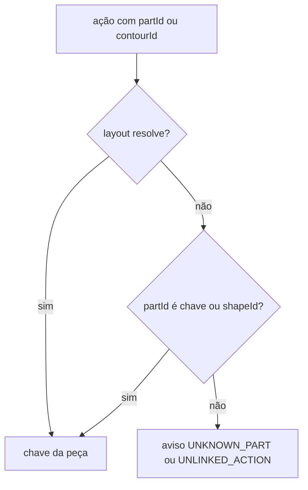

# linkParts

## Visão geral

Vincula as ações de corte de uma chapa às peças posicionadas nela. Módulo interno.

## Responsabilidades

- Delegar a resolução a `linkActions` (módulo compartilhado com o custo).
- Transformar cada achado estruturado em um aviso em pt-BR (`UNKNOWN_PART` ou `UNLINKED_ACTION`).
- Expor o mesmo resolvedor para os problemas de planejamento.

## Entradas e saídas

```ts
export function linkParts(args: LinkPartsArgs): LinkPartsResult
```

Entrada: `sheetId`, `partKeys`, `layout?`, `actions`. Saída: `partKeyByAction`, `resolve`, `notices`.

## Fluxo principal



## Tratamento de erros e casos-limite

Ação sem `partId` e sem `contourId` (por exemplo `end`) não gera aviso. Cada referência não
resolvida gera um único aviso, com a primeira ação em que apareceu.

## Exemplos

```ts
const { partKeyByAction } = linkParts({ sheetId: 'sheet-1', partKeys: ['part-1#0'], actions })
```

## Dependências e integrações

`../linking/linkActions`, `../cutPath/types`, `./messages` e `./types`.
