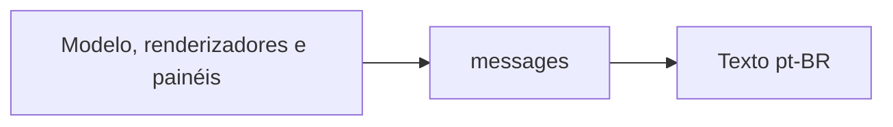

# Mensagens da revisão

## Visão geral

Módulo interno que concentra todo texto voltado ao usuário produzido pela revisão, em português
do Brasil. Não é exportado pelo barrel.

## Responsabilidades

- Fornecer mensagens de avisos, rótulos, legenda, anúncios e texto do resumo.
- Garantir um único ponto para idioma e terminologia.
- Reunir os textos do painel de edição e os anúncios de veredito, confirmação, recusa, desfazer e refazer, e o rótulo de frescor de cada resultado derivado.
- Reunir os textos do painel de risco (indicativo, resumo, regras não avaliadas, severidade e rótulos) e os da comparação e do recálculo.
- Reunir os textos da chave de calor, do calor máximo, do calor indisponível e dos marcadores da linha do tempo.

## Entradas e saídas

Funções puras que recebem identificadores ou números e retornam `string`; rótulos estáticos em
objetos `controls`, `panels`, `identityLabels` e `inspectLabels`.

## Fluxo principal



## Tratamento de erros e casos-limite

Mensagens vindas do artefato ou do plano de corte não passam por este módulo: são exibidas como
foram recebidas.

## Exemplos

```ts
messages.emptySheet('sheet-1') // "A chapa sheet-1 não tem peças posicionadas."
```

## Dependências e integrações

Somente tipos de `../cutPath/types` e `./types`.
