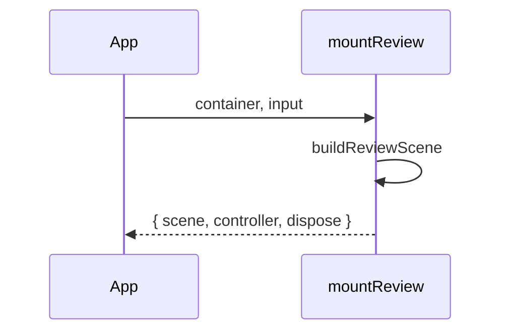

# mountReview

## Visão geral

Monta a revisão somente leitura de um artefato em um contêiner: identificação, seletor de chapa,
controles de reprodução, vista (acelerada ou estática) e avisos.

## Responsabilidades

- Construir a cena e os painéis semânticos (`section`, `header`, `nav`, `figure`, `aside`).
- Trocar a chapa exibida sem alterar o artefato.
- Usar o renderizador acelerado quando fornecido e funcional; caso contrário ou ao falhar, usar a vista estática na mesma posição, com aviso.
- Nunca iniciar a reprodução sozinho.
- Tornar a vista focável por teclado, exibir o resumo escrito, a lista de atalhos e anunciar mudanças na região `role="status"`.
- Selecionar peça ou ação por clique (tolerância de 6 px; clicar de novo no mesmo ponto passa ao próximo item sobreposto) e anunciar a seleção em uma região `role="status"`.
- Mostrar os motivos quando a revisão está indisponível, em vez de uma vista vazia.

## Entradas e saídas

```ts
export async function mountReview(container: HTMLElement, input: ReviewInput, options?: ReviewMountOptions): Promise<ReviewMount>
```

## Fluxo principal



## Tratamento de erros e casos-limite

Cena `unavailable` não tem figura nem seletor; os avisos explicam o motivo.

## Exemplos

```ts
const review = await mountReview(host, { artifact })
review.dispose()
```

## Dependências e integrações

`./buildScene`, `./attachSession` (que compõe `startRenderers`, `buildPanels`, `attachPointer` e `bindState`), `identityPanel`, `summaryPanel`, `noticesPanel` e `./messages`.
