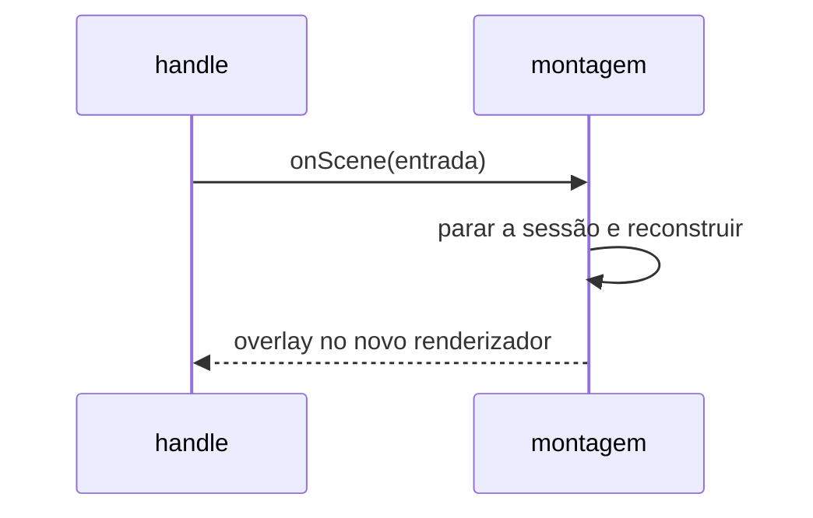

# review/mountEditable

## Visão geral

Monta a revisão editável: o painel de edição fica no lugar e o resto é reconstruído a partir da cena editada depois de cada confirmação, desfazer ou refazer.

## Responsabilidades

- Manter chapa, seleção e viewport na reconstrução e devolver o foco à vista.
- Capturar as teclas de edição somente quando o modo de edição está ligado e a peça está escolhida.
- Ligar o arrasto, o overlay e os anúncios ao handle de edição.
- Manter também o painel de risco no lugar durante as reconstruções e montar a configuração de recálculo a partir das opções `edit.recompute` e `risk`.
- Mesclar o fantasma da edição e as camadas de risco pelo hub de overlay e acompanhar a reprodução da sessão reconstruída.

## Entradas e saídas

```ts
export async function mountEditable(root: HTMLElement, input: ReviewInput, options: ReviewMountOptions): Promise<EditableMount>
```

## Fluxo principal



## Tratamento de erros e casos-limite

As reconstruções são serializadas em uma cadeia de promessas, então edições rápidas não se atropelam.

## Exemplos

```ts
const editable = await mountEditable(root, input, options)
```

## Dependências e integrações

`./editCommands`, `./editPanel`, `./attachDrag`, `./editKeyMap` e `./populateReview`.
