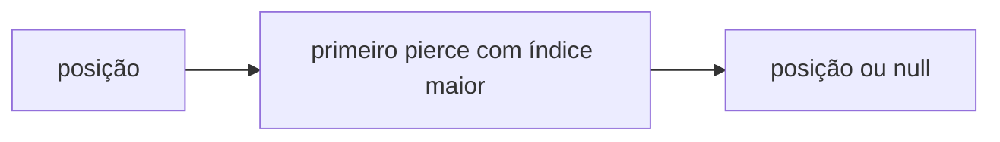

# nextPierce

## Visão geral

Encontra a posição da próxima perfuração após a ação atual.

## Responsabilidades

- Dar suporte ao comando de avanço até a próxima perfuração.

## Entradas e saídas

```ts
export function nextPierce(scene: ReviewScene, position: ReviewPosition): ReviewPosition | null
```

## Fluxo principal



## Tratamento de erros e casos-limite

Devolve `null` quando não há perfuração depois da ação atual.

## Exemplos

```ts
nextPierce(scene, { sheetId: "sheet-1", actionIndex: 0, progress: 0 })
```

## Dependências e integrações

`./types`.
