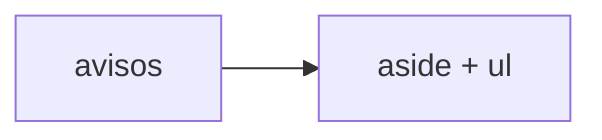

# noticesPanel

## Visão geral

Lista de avisos dentro de um `aside`; a ausência de avisos é exibida explicitamente.

## Responsabilidades

- Mostrar código e mensagem de cada aviso, com a severidade em `data-severity`.

## Entradas e saídas

```ts
export function noticesPanel(doc: Document, notices: readonly ReviewNotice[]): HTMLElement
```

## Fluxo principal



## Tratamento de erros e casos-limite

Lista vazia mostra "Nenhum aviso.".

## Exemplos

```ts
notices.replaceWith(noticesPanel(doc, state.notices))
```

## Dependências e integrações

`./messages`, `./panelText` e `./types`.
