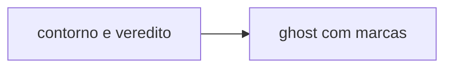

# review/overlay

## Visão geral

Monta o overlay de uma posição candidata: contorno, validade e uma marca de texto por violação, para que a recusa seja legível sem depender de cor.

## Responsabilidades

- Calcular a âncora no centro do contorno candidato.
- Produzir uma marca com código e rótulo para cada violação do veredito.

## Entradas e saídas

```ts
export function ghostOverlay(outline: readonly Point2D[], verdict: PlacementVerdict): ReviewOverlay
```

## Fluxo principal



## Tratamento de erros e casos-limite

Um veredito válido produz um contorno sem marcas.

## Exemplos

```ts
renderer.overlay?.(ghostOverlay(outline, verdict))
```

## Dependências e integrações

`../polygonUtils` e `../edit/types`.
