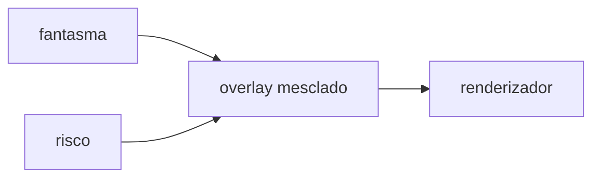

# review/overlayHub

## Visão geral

Combina a posição candidata da edição e as camadas de risco no único overlay que o renderizador desenha.

## Responsabilidades

- Mesclar o fantasma da edição com as camadas de risco, com o fantasma por cima.
- Redesenhar sob demanda, por exemplo em um renderizador recém-criado.

## Entradas e saídas

```ts
export function createOverlayHub(draw: (overlay: ReviewOverlay | null) => void): OverlayHub
```

## Fluxo principal



## Tratamento de erros e casos-limite

Sem fantasma e sem risco o overlay é limpo com nulo.

## Exemplos

```ts
const hub = createOverlayHub((overlay) => renderer.overlay?.(overlay))
```

## Dependências e integrações

`./types`.
