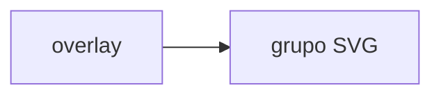

# review/overlaySvg

## Visão geral

Desenha o overlay da revisão em SVG, em coordenadas da chapa.

## Responsabilidades

- Desenhar o contorno candidato tracejado e hachurado quando inválido e sólido quando válido.
- Escrever o texto de cada violação ao lado do contorno, com o texto corrigido para a chapa espelhada.
- Desenhar o calor acumulado (hachurado onde passa do limite), as peças livres (contorno pontilhado) e um losango rotulado por achado.

## Entradas e saídas

```ts
export function overlayLayer(overlay: ReviewOverlay | null | undefined, unit: number): string
```

## Fluxo principal



## Tratamento de erros e casos-limite

Sem overlay devolve texto vazio.

## Exemplos

```ts
const markup = overlayLayer(overlay, unit)
```

## Dependências e integrações

`../toNestedSvg` e `./types`.
