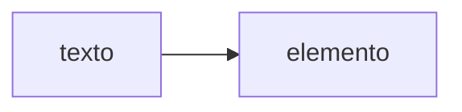

# text (painéis)

## Visão geral

Cria um elemento cujo conteúdo é texto, nunca marcação. Módulo interno dos painéis.

## Responsabilidades

- Evitar `innerHTML` nos painéis, de modo que dados do artefato nunca virem marcação.

## Entradas e saídas

```ts
export function text(doc: Document, tag: string, content: string, className?: string): HTMLElement
```

## Fluxo principal



## Tratamento de erros e casos-limite

Sempre usa `textContent`.

## Exemplos

```ts
text(doc, 'h2', messages.panels.identity)
```

## Dependências e integrações

Apenas DOM.
