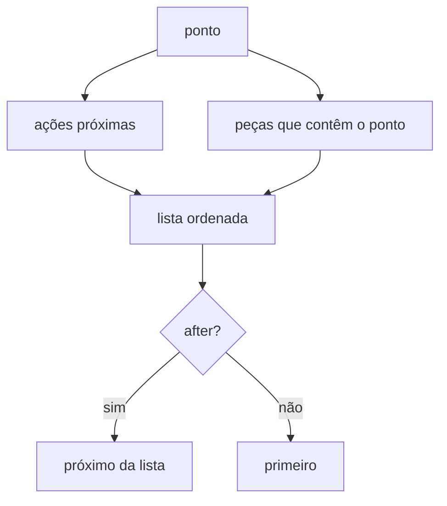

# pickAt

## Visão geral

Encontra a peça ou a ação sob um ponto de uma chapa, de forma determinística.

## Responsabilidades

- Ordenar candidatos: ações por índice na linha do tempo e, depois, peças na ordem da chapa.
- Considerar uma ação atingida quando o ponto está a uma distância de até `tolerance` do seu caminho.
- Considerar uma peça atingida quando o ponto está dentro do contorno externo e fora dos furos.
- Com `after`, devolver o candidato seguinte (com retorno ao primeiro), para alcançar itens sobrepostos.

## Entradas e saídas

```ts
export function pickAt(scene: ReviewScene, sheetId: string, point: Point2D, tolerance: number, after?: ReviewSelection | null): ReviewSelection | null
```

## Fluxo principal



## Tratamento de erros e casos-limite

Chapa desconhecida ou ponto sem candidatos devolve `null`.

## Exemplos

```ts
const hit = pickAt(scene, 'sheet-1', { x: 2.2, y: 12 }, 0.5)
```

## Dependências e integrações

`../cutPath/geometry` (`pointToSegmentDistance`), `../polygonUtils` (`pointInPolygon`), `../linking/actionPath` e `./types`.
