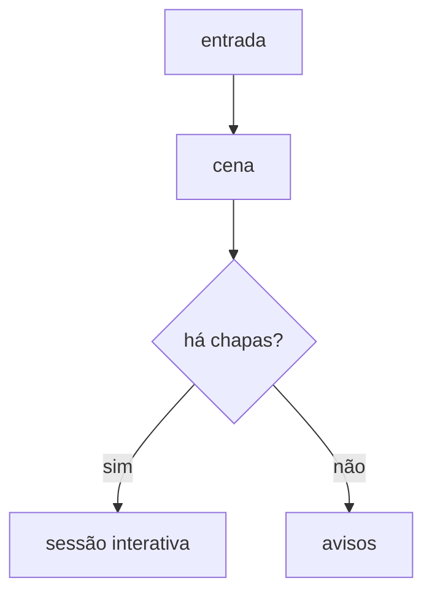

# review/populateReview

## Visão geral

Preenche a raiz da revisão: identificação, resumo e a sessão interativa, ou os avisos quando não há o que mostrar.

## Responsabilidades

- Construir a cena de uma entrada.
- Montar a sessão interativa e devolver cena, controlador, renderizadores, vista e a função de parada.

## Entradas e saídas

```ts
export async function populateReview(root: HTMLElement, input: ReviewInput, options: ReviewMountOptions, restore?): Promise<PopulatedReview>
```

## Fluxo principal



## Tratamento de erros e casos-limite

Uma cena sem chapas mostra os avisos em vez de uma vista vazia.

## Exemplos

```ts
const populated = await populateReview(root, input, options)
```

## Dependências e integrações

`./attachSession`, `./buildScene` e os painéis de identificação, resumo e avisos.
