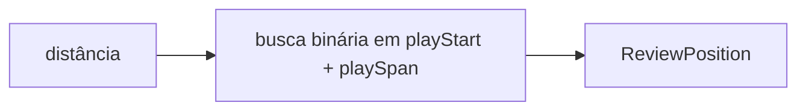

# positionAtDistance

## Visão geral

Converte uma distância no eixo de reprodução em uma posição de revisão. Módulo interno.

## Responsabilidades

- Garantir correspondência um para um: cada ação tem extensão positiva (as sem comprimento recebem uma permanência).
- Usar busca binária.

## Entradas e saídas

```ts
export function positionAtDistance(timeline: ReviewTimeline, sheetId: string, distance: number): ReviewPosition
```

## Fluxo principal



## Tratamento de erros e casos-limite

Distância menor ou igual a zero resulta no início; maior ou igual ao total resulta na posição final.

## Exemplos

```ts
positionAtDistance(timeline, "sheet-1", action.playStart) // { actionIndex, progress: 0 }
```

## Dependências e integrações

`./types`.
