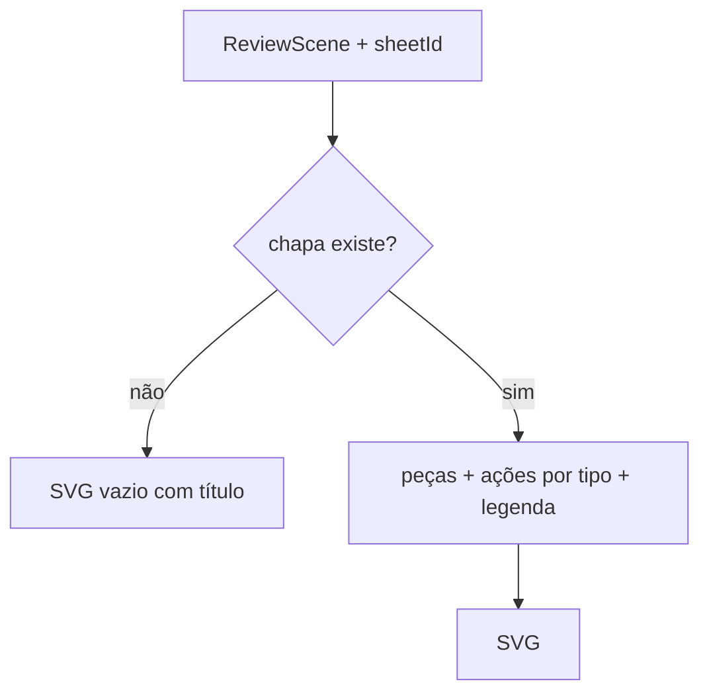

# renderReviewSvg

## Visão geral

Renderizador estático da revisão: gera uma string SVG autossuficiente, sem DOM, de uma chapa da
cena. É a vista de contingência e a vista acessível.

## Responsabilidades

- Desenhar a borda da chapa, as peças (preenchidas; hachuradas e tracejadas quando `flagged`) e
  as ações agrupadas por tipo.
- Distinguir tipos de ação por estilo de traço ou forma de marcador, nunca só por cor.
- Com `viewport`, mostrar uma janela da chapa (zoom e centro) em vez da chapa inteira com legenda.
- Destacar a peça ou a ação selecionada (`data-selected`, `data-selected-action`).
- Incluir título, descrição e legenda em pt-BR.
- Com `position`, desenhar a trilha (`data-trail`), as ações restantes esmaecidas (`data-remaining`) e o marcador da cabeça (`data-head`), usando `stateAt`.

## Entradas e saídas

```ts
export function renderReviewSvg(scene: ReviewScene, options: RenderReviewSvgOptions): string
```

## Fluxo principal



## Tratamento de erros e casos-limite

Chapa inexistente resulta em desenho vazio explícito. Identificadores passam por escape XML. O
eixo Y é invertido em um único grupo de transformação.

## Exemplos

```ts
const svg = renderReviewSvg(scene, { sheetId: 'sheet-1' })
```

## Dependências e integrações

`../toNestedSvg` (`escapeXml`), `./stateAt`, `./actionPrefix`, `./messages` e `./types`.
