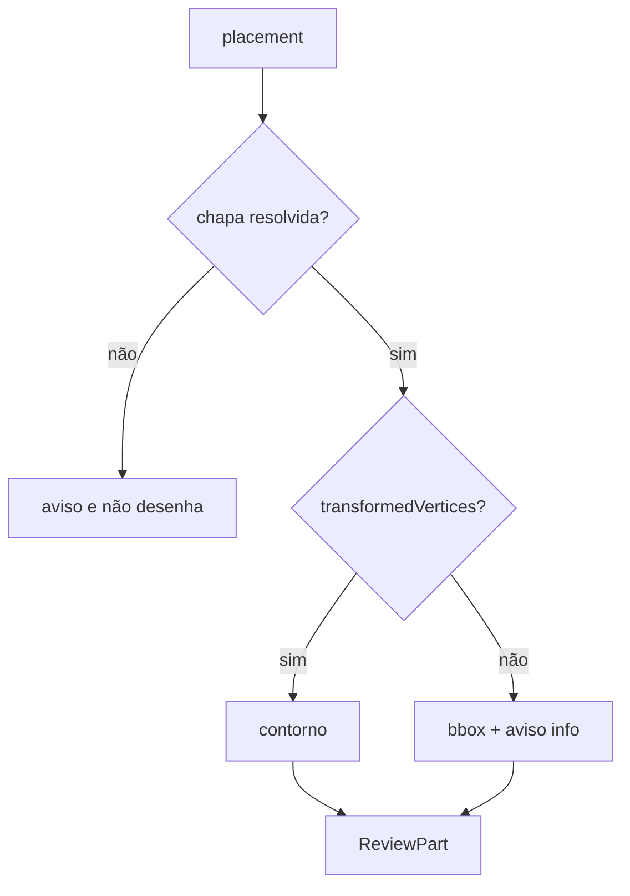

# resolvePlacements

## Visão geral

Transforma os placements do artefato em peças por chapa sem descartar nem adivinhar nenhum.
Módulo interno.

## Responsabilidades

- Chapa: `sheetId`, senão a única chapa, senão avisa `PLACEMENT_SHEET_UNRESOLVED` e não desenha.
- Instância: `instanceIndex`, senão a ordem entre placements da mesma forma.
- Contorno: `transformedVertices`, senão o retângulo `bbox` com aviso `PLACEMENT_GEOMETRY_APPROXIMATE`.
- Placement composto: uma peça com os contornos externo e dos furos.

## Entradas e saídas

```ts
export function resolvePlacements(
  layout: ArtifactLayout,
  sheets: readonly StockItem[],
  shapes: ReadonlyMap<string, NestableShape>,
): ResolvedPlacements
```

## Fluxo principal



## Tratamento de erros e casos-limite

Os dados de origem (`layer`, `originalHandle`, área, perímetro) só aparecem quando a forma está
disponível pelo `CutLayout`; nada é inventado.

## Exemplos

```ts
const { partsBySheet, notices } = resolvePlacements(layout, stocks, shapes)
```

## Dependências e integrações

`../types`, `../erp/types`, `./messages` e `./types`.
