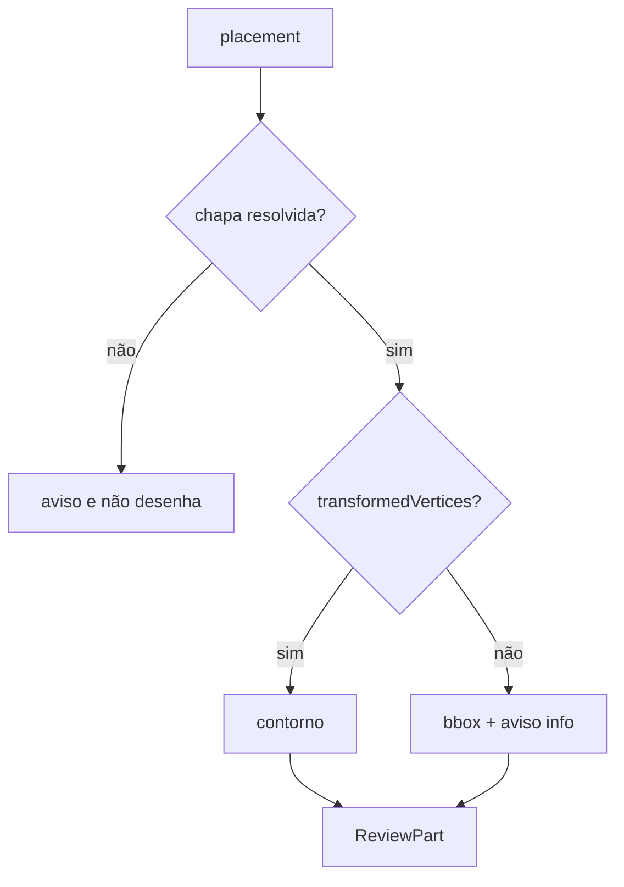

# resolvePlacements

## Visão geral

Transforma os placements do artefato em peças por chapa sem descartar nem adivinhar nenhum.
Módulo interno.

## Responsabilidades

- Delegar a resolução (chapa, instância, contorno e compostos) a `placedParts`, módulo compartilhado com o custo.
- Acrescentar os dados de origem das formas disponíveis pelo `CutLayout`.
- Transformar cada achado em aviso pt-BR (`PLACEMENT_SHEET_UNRESOLVED` ou `PLACEMENT_GEOMETRY_APPROXIMATE`).

## Entradas e saídas

```ts
export function resolvePlacements(
  layout: ArtifactLayout,
  sheets: readonly StockItem[],
  shapes: ReadonlyMap<string, NestableShape>,
): ResolvedPlacements
```

## Fluxo principal



## Tratamento de erros e casos-limite

Os dados de origem (`layer`, `originalHandle`, área, perímetro) só aparecem quando a forma está
disponível pelo `CutLayout`; nada é inventado.

## Exemplos

```ts
const { partsBySheet, notices } = resolvePlacements(layout, stocks, shapes)
```

## Dependências e integrações

`../linking/placedParts`, `../types`, `../erp/types`, `./messages` e `./types`.
