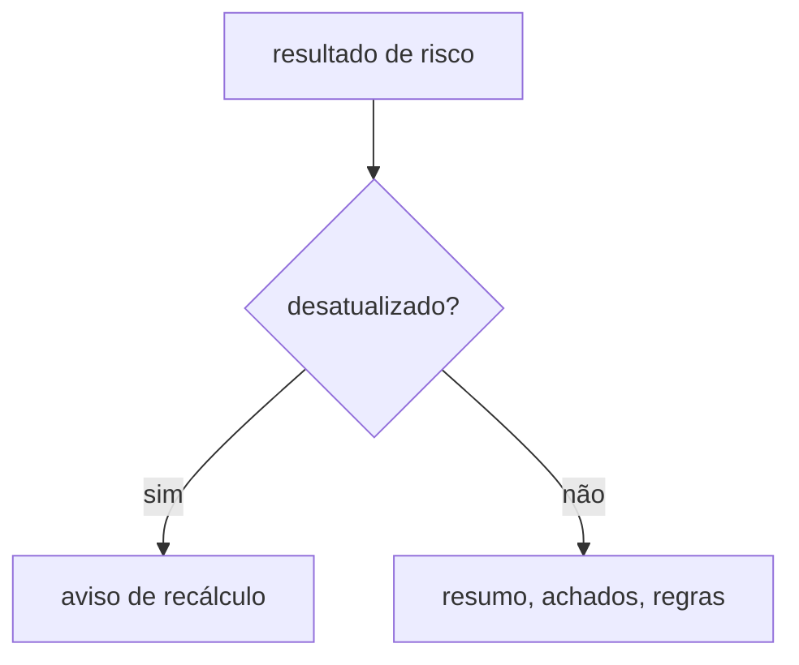

# review/riskPanel

## Visão geral

Painel de risco de corte: declara que o resultado é indicativo, mostra quantas regras foram avaliadas, cada achado em texto e as regras que não puderam ser avaliadas, com a entrada que falta.

## Responsabilidades

- Mostrar cada achado com severidade em texto, categoria, peça ou região, momento, valor medido, limite, motivo e sugestão de mitigação.
- Avisar que o risco está desatualizado depois de uma edição, até o recálculo.
- Usar apenas HTML semântico e texto para a severidade, sem depender de cor.
- Oferecer a chave de calor acumulado, o texto do calor máximo, os marcadores da linha do tempo (botões que vão até o achado) e anunciar a mudança do número de achados.

## Entradas e saídas

```ts
export function riskPanel(doc: Document): RiskPanelHandle
```

## Fluxo principal



## Tratamento de erros e casos-limite

Resultado indisponível mostra o aviso correspondente. A sugestão nunca é aplicada automaticamente.

## Exemplos

```ts
const panel = riskPanel(document)
panel.update(result, false)
```

## Dependências e integrações

`./messages` e `./panelText`.
