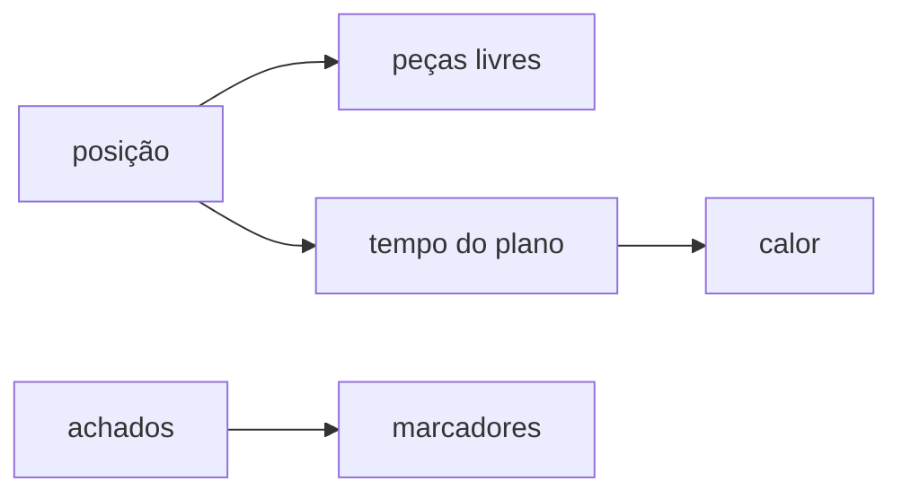

# review/riskPlayback

## Visão geral

Prepara as vistas de risco da reprodução: peças livres em cada instante, calor acumulado e um marcador por achado,.

## Responsabilidades

- Construir o contexto de risco uma vez, de modo que avançar e voltar no tempo é barato e dá overlays idênticos.
- Considerar livre a peça cuja ação de liberação já foi concluída e que não está presa por ponte.
- Nunca produzir campos de animação.

## Entradas e saídas

```ts
export function createRiskPlayback(request: RiskRequest, result: RiskResult): RiskPlayback | null
```

## Fluxo principal



## Tratamento de erros e casos-limite

O calor fica indisponível, com o motivo, quando falta velocidade ou limite. Sem plano utilizável devolve nulo.

## Exemplos

```ts
const playback = createRiskPlayback(request, result)
const overlay = playback?.overlayAt(position, true)
```

## Dependências e integrações

`../risk` e `./messages`.
