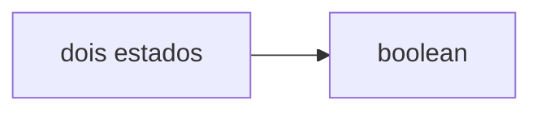

# sameState

## Visão geral

Compara dois estados do controlador campo a campo, sem serialização. Módulo interno.

## Responsabilidades

- Evitar emissões repetidas do estado.

## Entradas e saídas

```ts
export function sameState(a: ReviewState, b: ReviewState): boolean
```

## Fluxo principal



## Tratamento de erros e casos-limite

Avisos comparam por identidade de item.

## Exemplos

```ts
if (sameState(current, next)) return
```

## Dependências e integrações

`./types`.
