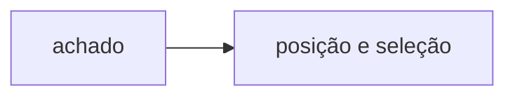

# review/seekTargetOf

## Visão geral

Diz para onde a revisão deve ir para mostrar um achado de risco: o início da ação do achado e a peça ou a ação a que ele se refere.

## Responsabilidades

- Selecionar a peça quando o achado tem peça e a ação quando não tem.
- Ir ao início do plano quando o achado não tem ação.

## Entradas e saídas

```ts
export function seekTargetOf(finding: RiskFinding): { position: ReviewPosition; selection: ReviewSelection }
```

## Fluxo principal



## Tratamento de erros e casos-limite

Um achado sem ação leva ao início da chapa.

## Exemplos

```ts
const target = seekTargetOf(finding)
controller.seek(target.position)
```

## Dependências e integrações

`../risk/types` e `./types`.
