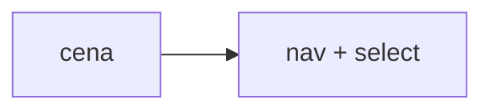

# sheetSwitcher

## Visão geral

Navegação com seletor rotulado de chapa.

## Responsabilidades

- Chamar o retorno com a chapa escolhida; o estado vem do controlador.

## Entradas e saídas

```ts
export function sheetSwitcher(doc: Document, scene: ReviewScene, current: string, onChange: (sheetId: string) => void): HTMLElement
```

## Fluxo principal



## Tratamento de erros e casos-limite

Uma chapa apenas ainda exibe o seletor.

## Exemplos

```ts
sheetSwitcher(doc, scene, first, (id) => controller.selectSheet(id))
```

## Dependências e integrações

`./messages` e `./types`.
