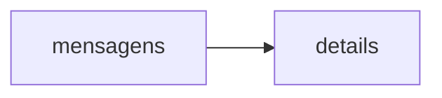

# shortcutsPanel

## Visão geral

Lista recolhível de atalhos de teclado.

## Responsabilidades

- Listar os atalhos de `messages.shortcutLines`.

## Entradas e saídas

```ts
export function shortcutsPanel(doc: Document): HTMLElement
```

## Fluxo principal



## Tratamento de erros e casos-limite

Todas as funções também têm controle rotulado.

## Exemplos

```ts
root.appendChild(shortcutsPanel(doc))
```

## Dependências e integrações

`./messages` e `./panelText`.
