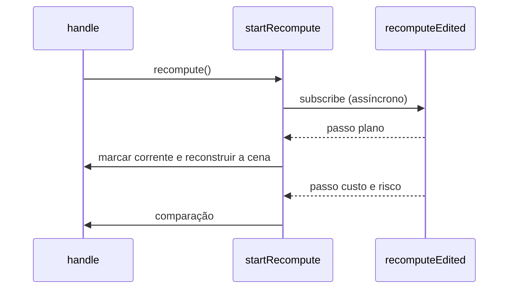

# review/startRecompute

## Visão geral

Inicia o recálculo do layout editado e aplica cada passo conforme ele chega: plano, custo e risco, com a comparação com o original ao final.

## Responsabilidades

- Entregar os passos em turnos separados do laço de eventos, para o usuário poder editar entre eles.
- Descartar um passo que partiu de uma revisão antiga, sem marcar o resultado como corrente, e encerrar a execução com `RECOMPUTE_DISCARDED`.
- Reconstruir a cena com o plano novo quando o passo do plano termina.
- Comparar o layout editado com o original ao concluir.

## Entradas e saídas

```ts
export function startRecompute(deps: RecomputeDeps): Subscription
```

## Fluxo principal



## Tratamento de erros e casos-limite

Uma edição entre dois passos faz o passo seguinte ser descartado e avisa o usuário. Falha de um passo mantém o layout editado e mostra o motivo.

## Exemplos

```ts
const run = startRecompute({ input, config, session, update, plans, risks, onPlan, emit, announce })
```

## Dependências e integrações

`../edit` e `./messages`.
