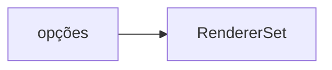

# startRenderers

## Visão geral

Inicia o renderizador estático e, quando há fábrica, tenta o acelerado. Módulo interno da montagem.

## Responsabilidades

- Devolver o conjunto de renderizadores e os avisos de partida.
- Cair para a vista estática quando a fábrica falha.

## Entradas e saídas

```ts
export async function startRenderers(view: HTMLElement, options: ReviewMountOptions): Promise<RendererSet>
```

## Fluxo principal



## Tratamento de erros e casos-limite

Fábrica que rejeita ou que lança de forma síncrona gera o aviso `GRAPHICS_UNAVAILABLE` e mantém a vista estática.

## Exemplos

```ts
const renderers = await startRenderers(view, options)
```

## Dependências e integrações

`./svgRenderer`, `./graphicsNotice` e `./types`.
