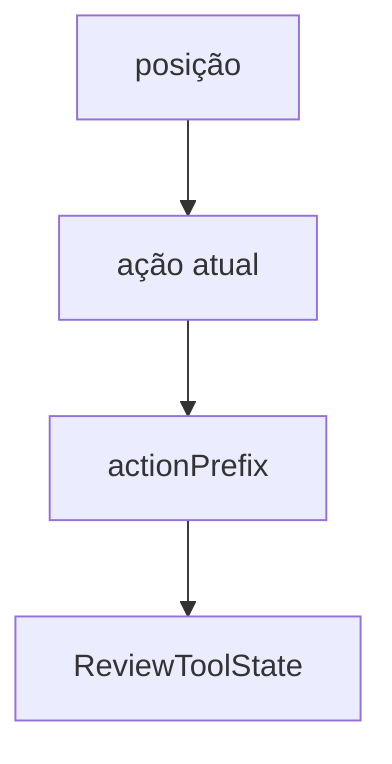

# stateAt

## Visão geral

Única função que deriva o estado exibido (cabeça, ações concluídas e ação atual) a partir de uma posição.

## Responsabilidades

- Garantir que reproduzir, buscar e avançar mostrem o mesmo estado para a mesma posição.

## Entradas e saídas

```ts
export function stateAt(scene: ReviewScene, position: ReviewPosition): ReviewToolState
```

## Fluxo principal



## Tratamento de erros e casos-limite

Chapa sem linha do tempo devolve estado vazio. Índice fora do intervalo é limitado. Na posição final, `current` é nulo e a cabeça fica no último ponto.

## Exemplos

```ts
const { head, completed, current } = stateAt(scene, position)
```

## Dependências e integrações

`./actionPrefix` e `./types`.
