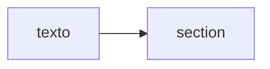

# summaryPanel

## Visão geral

Seção com o resumo escrito da cena, sempre presente ao lado da vista.

## Responsabilidades

- Exibir o texto de `summarize`.

## Entradas e saídas

```ts
export function summaryPanel(doc: Document, summary: string): HTMLElement
```

## Fluxo principal



## Tratamento de erros e casos-limite

Cena indisponível ainda tem resumo.

## Exemplos

```ts
summaryPanel(doc, summarize(scene))
```

## Dependências e integrações

`./messages` e `./panelText`.
