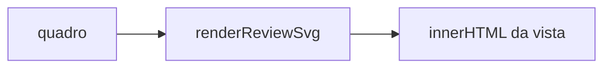

# createSvgRenderer

## Visão geral

Adapta o desenho SVG estático a um `ReviewRenderer`, para que o controlador o conduza como qualquer outro. Módulo interno.

## Responsabilidades

- Redesenhar a chapa a cada quadro, com posição e seleção.
- Repassar a vista (`viewport`) ao desenho.
- Converter o ponteiro em coordenadas da chapa (`pointAt`) pela matriz de tela do grupo da chapa.
- Guardar o overlay recebido e redesenhá-lo junto com cada quadro, sem perdê-lo quando a vista é redesenhada.

## Entradas e saídas

```ts
export function createSvgRenderer(view: HTMLElement): ReviewRenderer
```

## Fluxo principal



## Tratamento de erros e casos-limite

O renderizador estático não falha; `dispose` limpa a vista.

## Exemplos

```ts
const renderer = createSvgRenderer(view)
```

## Dependências e integrações

`./renderSvg` e `./types`.
