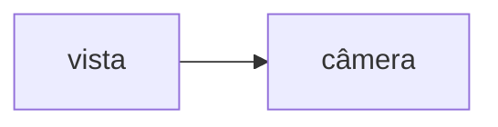

# fitCamera

## Visão geral

Ajusta a câmera ortográfica para que a chapa inteira fique visível no zoom e centro da vista.

## Responsabilidades

- Ajustar por largura ou altura, o que exigir mais.

## Entradas e saídas

```ts
export function fitCamera(camera, stock, viewport, aspect): void
```

## Fluxo principal



## Tratamento de erros e casos-limite

Zoom maior que 1 reduz a janela visível.

## Exemplos

```ts
fitCamera(camera, sheet.stock, frame.viewport, height / width)
```

## Dependências e integrações

`three` (tipos).
