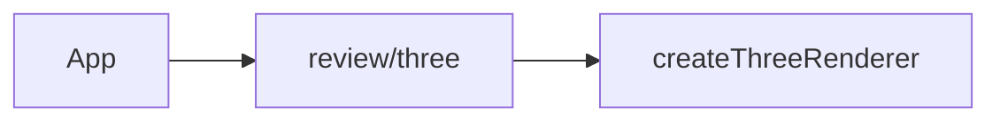

# Subcaminho review/three

## Visão geral

Ponto de entrada do renderizador acelerado, publicado em `@linkiez/dxf-renew/review/three`. O barrel principal não o importa.

## Responsabilidades

- Reexportar `createThreeRenderer`, `ReviewGraphicsError` e os tipos de opções.

## Entradas e saídas

Ver `renderer.doc.md`.

## Fluxo principal



## Tratamento de erros e casos-limite

Consumidores sem `three` instalado usam apenas a revisão estática.

## Exemplos

```ts
import { createThreeRenderer } from '@linkiez/dxf-renew/review/three'
```

## Dependências e integrações

`three` como dependência par opcional.
