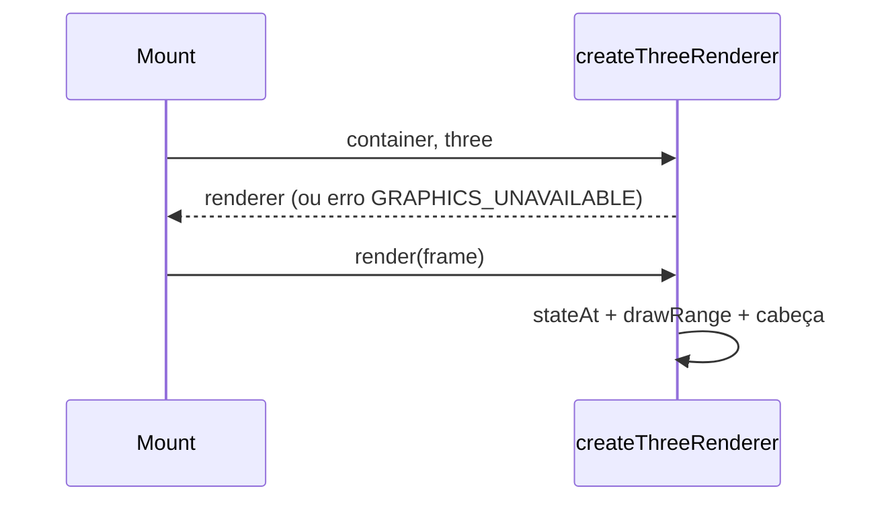

# createThreeRenderer

## Visão geral

Renderizador acelerado de vista superior ortográfica. Recebe o namespace `three` (ou um carregador) do chamador e nunca o importa em tempo de execução.

## Responsabilidades

- Manter um número constante de objetos na cena; a trilha é um intervalo de desenho (`drawRange`) de cada buffer.
- Mover um único marcador de cabeça e desenhar a parte executada da ação atual.
- Enquadrar a chapa inteira na câmera, destacar a seleção, converter o ponteiro em coordenadas da chapa (`pointAt`) e redesenhar quando o contêiner muda de tamanho.
- Reportar `GRAPHICS_UNAVAILABLE` (rejeição na criação) e `GRAPHICS_LOST` (perda de contexto).

## Entradas e saídas

```ts
export async function createThreeRenderer(options: CreateThreeRendererOptions): Promise<ReviewRenderer>
```

## Fluxo principal



## Tratamento de erros e casos-limite

Sem WebGL2 ou sem `three`, a criação rejeita com `ReviewGraphicsError`. Trocar de chapa reconstrói os objetos e libera os anteriores. Os tipos de `three` exigem `@types/three` no consumidor.

## Exemplos

```ts
const renderer = await createThreeRenderer({ container, three: () => import('three') })
```

## Dependências e integrações

`three` (par opcional, ADR-0003), `../stateAt`, `../actionPrefix`, `./sheetObjects`, `./fitCamera`, `./updateTrail`, `./updatePartial`, `./updateSelection`, `./palette` e `./graphicsError`.
