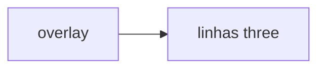

# review/three/updateOverlay

## Visão geral

Camada do overlay na vista acelerada: contorno candidato tracejado quando inválido e uma cruz por violação.

## Responsabilidades

- Substituir o conteúdo da camada a cada overlay e liberar geometrias e materiais anteriores.
- Não desenhar texto, pois o WebGL não o faz: o texto dos motivos fica no painel de edição.
- Desenhar as células de calor (tracejadas e cruzadas acima do limite), as peças livres e os achados como losangos.

## Entradas e saídas

```ts
export function createOverlayLayer(three: ThreeNamespace): OverlayLayer
```

## Fluxo principal



## Tratamento de erros e casos-limite

Sem overlay a camada fica vazia.

## Exemplos

```ts
const layer = createOverlayLayer(three)
```

## Dependências e integrações

`three` (injetado) e `../types`.
