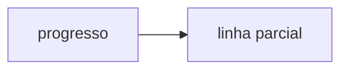

# updatePartial

## Visão geral

Desenha a parte já executada da ação atual e escolhe o material do tipo.

## Responsabilidades

- Reaproveitar o buffer pré-alocado da ação atual.

## Entradas e saídas

```ts
export function updatePartial(objects, state, progress, materialFor): void
```

## Fluxo principal



## Tratamento de erros e casos-limite

`pierce` e `end` não geram linha parcial.

## Exemplos

```ts
updatePartial(objects, state, progress, solidMaterial)
```

## Dependências e integrações

`../actionPrefix` e `./sheetObjects`.
