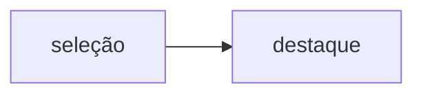

# updateSelection

## Visão geral

Redesenha o destaque da seleção quando ela muda.

## Responsabilidades

- Destacar o contorno da peça ou o caminho da ação selecionada.

## Entradas e saídas

```ts
export function updateSelection(objects, sheet, selection): void
```

## Fluxo principal



## Tratamento de erros e casos-limite

Seleção de outra chapa não desenha nada.

## Exemplos

```ts
updateSelection(objects, sheet, frame.selection)
```

## Dependências e integrações

`../actionPath` e `./sheetObjects`.
