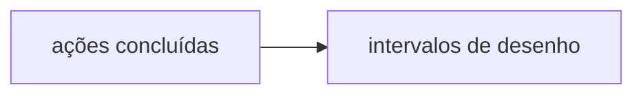

# updateTrail

## Visão geral

Define os intervalos de desenho e as contagens de marcadores para as ações concluídas.

## Responsabilidades

- Fazer a trilha ser um prefixo do buffer e o restante o fantasma.

## Entradas e saídas

```ts
export function updateTrail(objects: SheetObjects, completed: number): void
```

## Fluxo principal



## Tratamento de erros e casos-limite

Sem buffers, as contagens são zero.

## Exemplos

```ts
updateTrail(objects, state.completed)
```

## Dependências e integrações

`./lineKinds` e `./sheetObjects`.
