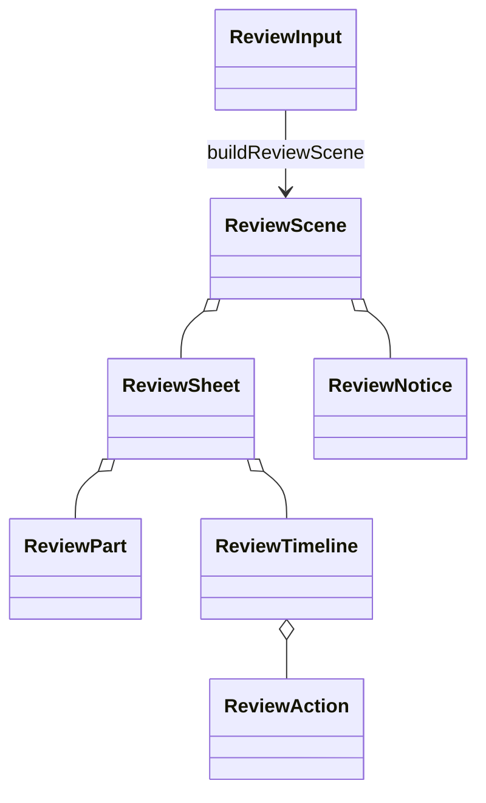

# Tipos da revisão de nesting

## Visão geral

Declara os tipos públicos da revisão somente leitura de um artefato de nesting: entrada, cena,
avisos, linha do tempo, posição, seleção, renderizador e controlador.

## Responsabilidades

- Definir também o eixo de reprodução (`playStart`, `playSpan`, `playTotal`), em que toda ação tem extensão positiva.
- Definir contratos imutáveis consumidos pelo modelo, pelos renderizadores e pelo controlador.
- Reutilizar `Placement`, `StockItem`, `CutPlanResult` e `ErpNestingArtifact` sem redefini-los.

## Entradas e saídas

- Entrada: `ReviewInput` (`artifact`, `layout?`, `cutPlan?`).
- Saída do modelo: `ReviewScene`, derivada somente dos dados recebidos.

## Fluxo principal



## Tratamento de erros e casos-limite

- `ReviewPosition.actionIndex` vai de `0` a `actions.length` (fim); `progress` fica em `[0, 1)`.
- `ReviewPart.status` é `flagged` quando há aviso ou erro registrado contra a peça ou suas ações.

## Exemplos

```ts
const position: ReviewPosition = { sheetId: 'sheet-1', actionIndex: 3, progress: 0 }
```

## Dependências e integrações

`../types`, `../cutPath/types`, `../erp/types` e `rxjs` (somente tipo `Observable`).
