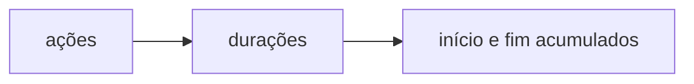

# risk/actionTimes

## Visão geral

Posiciona as ações de um plano no eixo do tempo do plano a partir das durações.

## Responsabilidades

- Usar `actionDuration` e `actionCategory`, de modo que custo e risco concordem sobre o tempo.
- Deixar o tempo nulo a partir da primeira ação cuja duração não pode ser calculada.

## Entradas e saídas

```ts
export function actionSchedule(actions, lengths, speeds, geometryUnitsPerMeter): ActionSchedule
```

## Fluxo principal



## Tratamento de erros e casos-limite

Velocidade ou tempo de perfuração ausente torna os tempos nulos dali em diante.

## Exemplos

```ts
const { starts, ends } = actionSchedule(actions, lengths, speeds, 1000)
```

## Dependências e integrações

`../linking/actionDuration`, `../linking/actionCategory` e `../linking/metadataNumber`.
