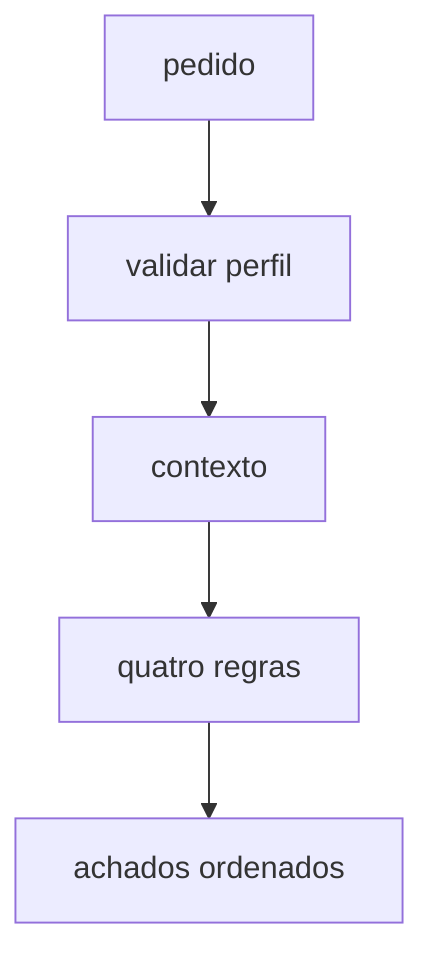

# risk/assessCutRisk

## Visão geral

Avalia um plano de corte quanto a calor, alma fina, peça solta e batida da cabeça, de forma indicativa e determinística.

## Responsabilidades

- Validar o perfil e devolver resultado indisponível com os motivos quando é inválido ou o plano não tem ações.
- Reportar como não avaliável a regra cujo limite falta e marcar o resultado como parcial.
- Ordenar os achados por severidade, categoria, chapa, ação e peça.
- Nunca alterar o pedido.

## Entradas e saídas

```ts
export function assessCutRisk(request: RiskRequest): RiskResult
```

## Fluxo principal



## Tratamento de erros e casos-limite

Sem fator crítico, os achados ficam `warning` e o aviso `SEVERITY_NOT_GRADED` é emitido.

## Exemplos

```ts
const result = assessCutRisk({ artifact, layout, cutPlan, profile })
```

## Dependências e integrações

`./riskContext`, as regras `./assess*` e `./validateRiskProfile`.
