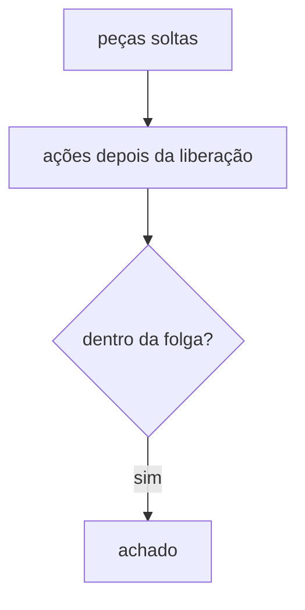

# risk/assessHeadStrike

## Visão geral

Regra 4: avisa de um caminho de corte ou de deslocamento que passa dentro da folga de uma peça solta depois de ela ser liberada.

## Responsabilidades

- Ignorar o movimento que sai da peça logo depois da liberação.
- Não considerar peças presas por ponte nem peças maiores que o limite de peça solta.
- Reportar cada peça uma vez, na primeira ação que a atinge.

## Entradas e saídas

```ts
export function assessHeadStrike(context: RiskContext): RiskFinding[]
```

## Fluxo principal



## Tratamento de erros e casos-limite

Sem a folga ou sem o limite de área a regra não é avaliável.

## Exemplos

```ts
const findings = assessHeadStrike(context)
```

## Dependências e integrações

`./freedMoments`, `./pathDistance` e `./buildFinding`.
