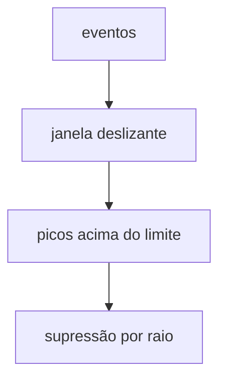

# risk/assessHeat

## Visão geral

Regra 1: avisa de uma região onde o comprimento cortado dentro do raio de calor, na janela final, passa do limite.

## Responsabilidades

- Varrer os eventos em ordem de tempo com uma janela deslizante por célula.
- Reportar cada região quente uma vez, pelo pico mais forte, com as demais a pelo menos um raio de distância.

## Entradas e saídas

```ts
export function assessHeat(context: RiskContext): RiskFinding[]
```

## Fluxo principal



## Tratamento de erros e casos-limite

Um intervalo de resfriamento maior que a janela zera o acúmulo.

## Exemplos

```ts
const findings = assessHeat(context)
```

## Dependências e integrações

`./heatEvents`, `./neighbourhoodLength` e `./buildFinding`.
