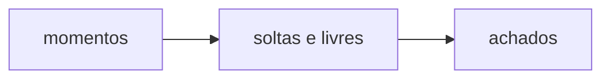

# risk/assessLoosePart

## Visão geral

Regra 3: avisa de uma peça que fica livre, sem ponte, com área igual ou menor que o limite, porque pode se mover ou levantar.

## Responsabilidades

- Medir a área em metros quadrados.
- Reportar a ação e o instante em que a peça é liberada.

## Entradas e saídas

```ts
export function assessLoosePart(context: RiskContext): RiskFinding[]
```

## Fluxo principal



## Tratamento de erros e casos-limite

Sem o limite de área a regra não é avaliável e devolve lista vazia.

## Exemplos

```ts
const findings = assessLoosePart(context)
```

## Dependências e integrações

`./freedMoments` e `./buildFinding`.
