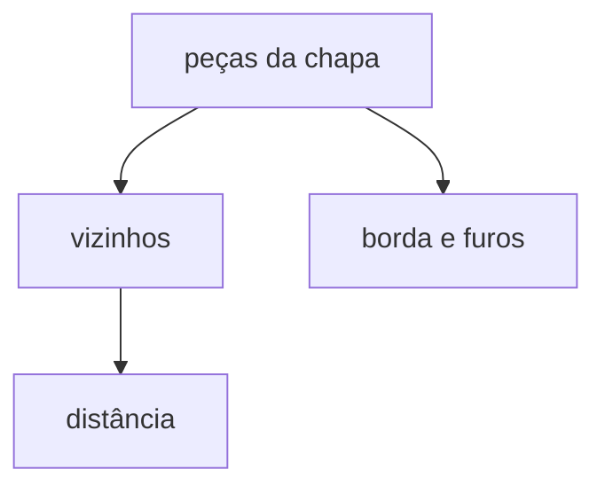

# risk/assessThinWeb

## Visão geral

Regra 2: avisa de duas peças, ou de uma peça e uma borda ou furo da chapa, mais próximas que a alma mínima.

## Responsabilidades

- Comparar só vizinhos próximos, usando o índice de vizinhança.
- Medir a menor distância entre contornos com `polygonDistance`.

## Entradas e saídas

```ts
export function assessThinWeb(context: RiskContext): RiskFinding[]
```

## Fluxo principal



## Tratamento de erros e casos-limite

Uma distância igual ao mínimo, dentro de `EPSILON`, não é achado.

## Exemplos

```ts
const findings = assessThinWeb(context)
```

## Dependências e integrações

`../linking/neighbourIndex`, `../trueShape/bounds` e `./buildFinding`.
