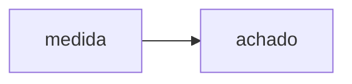

# risk/buildFinding

## Visão geral

Monta um achado com identificador estável, severidade e o motivo e a mitigação em português.

## Responsabilidades

- Gerar o identificador a partir da categoria, da chapa, das peças, da ação e da região.
- Escrever o motivo com o valor medido, o limite e a unidade.

## Entradas e saídas

```ts
export function buildFinding(spec: FindingSpec): RiskFinding
```

## Fluxo principal



## Tratamento de erros e casos-limite

O identificador é igual para o mesmo achado em execuções iguais.

## Exemplos

```ts
const finding = buildFinding(spec)
```

## Dependências e integrações

`./gradeSeverity` e `./messages`.
