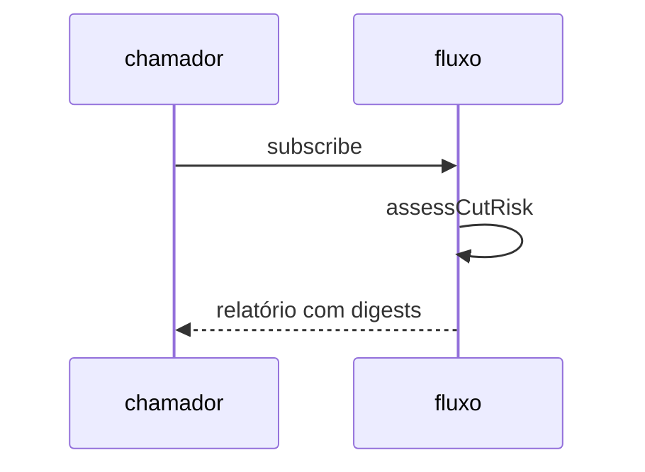

# risk/calculateRiskReport

## Visão geral

Avalia um plano e devolve um relatório auditável como Observable frio que emite e completa.

## Responsabilidades

- Rejeitar o Observable quando o artefato não passa no esquema da ERP.
- Incluir a correlação, os digests do artefato, o digest do perfil e o digest do próprio relatório.

## Entradas e saídas

```ts
export function calculateRiskReport(request: RiskRequest): Observable<RiskReport>
```

## Fluxo principal



## Tratamento de erros e casos-limite

Perfil inválido gera relatório indisponível, não erro. Entradas iguais dão digest igual.

## Exemplos

```ts
const report = await firstValueFrom(calculateRiskReport(request))
```

## Dependências e integrações

`../async/observableFlow`, `../erp` e `./assessCutRisk`.
