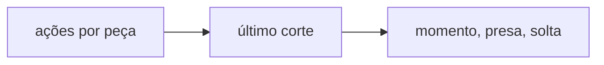

# risk/freedMoments

## Visão geral

Encontra o momento em que cada peça fica livre: o fim da sua última ação de corte, a menos que uma ponte a mantenha presa.

## Responsabilidades

- Marcar a peça como solta quando a área é igual ou menor que o limite.
- Ordenar por chapa, índice da ação e chave da peça.

## Entradas e saídas

```ts
export function freedMoments(context: RiskContext): FreedMoment[]
```

## Fluxo principal



## Tratamento de erros e casos-limite

Uma ação `tab` na peça a mantém presa. Sem velocidades, o tempo do momento é nulo.

## Exemplos

```ts
const moments = freedMoments(context)
```

## Dependências e integrações

`./riskContext`.
